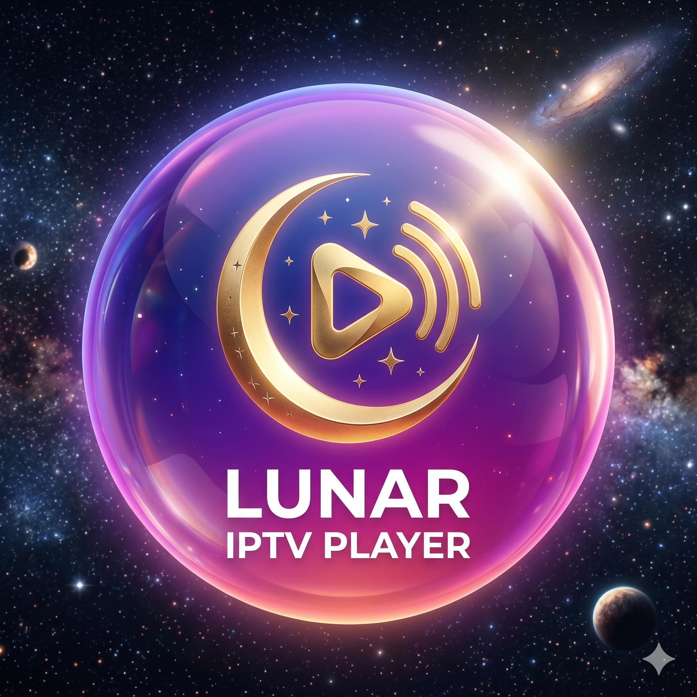
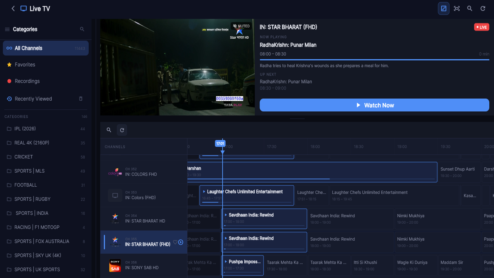
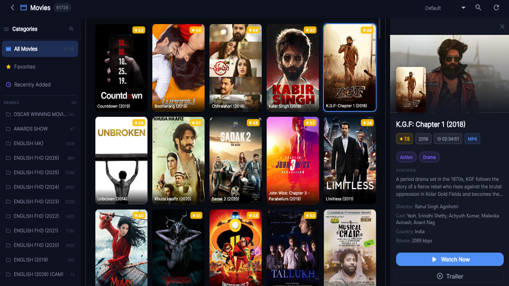
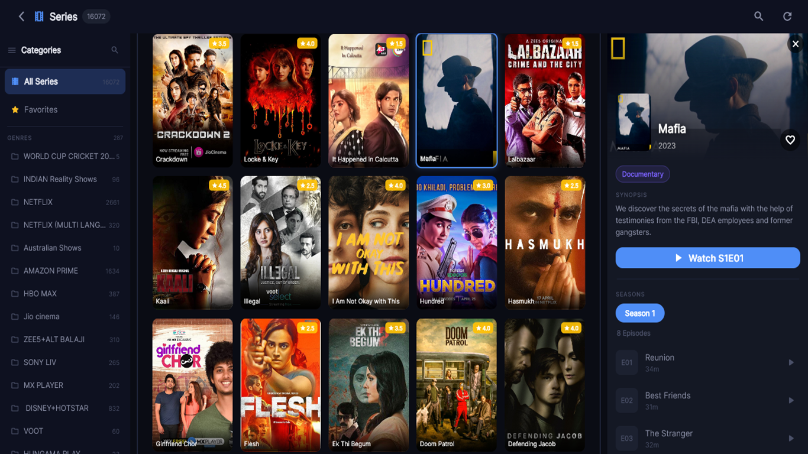

<div align="center">



# Lunar IPTV Player

**Your playlist, beautifully played.**

Live TV with a real programme guide, movies and series that remember where you stopped,<br/>and a player that feels just as good with a TV remote as with a mouse.

[](https://flutter.dev)
[](https://dart.dev)
[](https://lunar-iptv.web.app)

[](https://play.google.com/store/apps/details?id=com.iptv.lunar)
&nbsp;
[](https://apps.microsoft.com/detail/9pfjx05nf64l)

**[Website](https://lunar-iptv.web.app)** · **[Web app](https://lunar-iptv-app.web.app)** · **[Report a problem](https://github.com/rupesh9698/lunar-iptv-player/issues)**

</div>

<br/>

<div align="center">



| Movies | Series |
| :---: | :---: |
|  |  |

</div>

## What's inside

### 📺 Live TV
- **Programme guide timeline** with a live "now" line, channel numbers and search
- **Inline mini player** next to the guide; maximize with one press, channel up and down from the player
- **Enhanced TV Guide**: fills gaps with real programme names from public XMLTV guides, by region
- **4K channels** (H.265 / HEVC) where the device can decode them
- Favorites, Recently Viewed, hidden categories and **PIN locked categories**
- Reconnects on its own when a provider drops the stream

### 🎬 Movies and Series
- Big poster grids with Recently Added, ratings, languages and trailers
- **Continue Watching** that resumes at the exact second, on movies and episodes
- **Recommended for You** and **More Like This**, built from what you actually finish, never the same title twice
- Seasons and episodes browser, downloads where the platform allows

### ▶️ Player
- Loading ring around play, with the percentage inside
- **Audio and subtitle tracks by language name** ("Hindi", "English") instead of "Track 2"
- **Player lock**: Back on the remote, Esc on desktop, or a tap on the phone unlocks, with a hint when you press anything else
- Volume and brightness gestures on phones, keyboard and mouse on Windows

### 🎮 Made for Android TV
- Every screen, button and text field reachable with the D-pad
- The on-screen keyboard only opens when you press OK
- **Performance mode** keeps menus smooth on 2 GB TV boxes

### 📊 My Stats
- Watch time, day streaks, top genres, most watched and the hours you usually tune in
- Charts update live while you watch

### ⚙️ Everything else
- **Xtream Codes and M3U** playlists, as many as you like
- Sync screen that shows each step as it happens, then caches everything on the device
- In-app updates through Google Play and the Microsoft Store
- Landscape everywhere, from phones to TVs
- No account, no ads, no tracking

## Platforms

| Platform | Where to get it | Notes |
| --- | --- | --- |
| Android phones and tablets | [Google Play](https://play.google.com/store/apps/details?id=com.iptv.lunar) | Landscape only |
| Android TV and Google TV | Google Play on the TV | Full remote support |
| Windows 10 and 11 | [Microsoft Store](https://apps.microsoft.com/detail/9pfjx05nf64l) | |
| Web browser | [lunar-iptv-app.web.app](https://lunar-iptv-app.web.app) | Plays playlists that use `https://` addresses. Browsers block `http://` ones on a secure site, so use an app for those |
| iOS, macOS, Linux | Build from source | Not published yet |

## Build it yourself

You need the Flutter SDK (3.47 or newer, Dart 3.11) and an Xtream Codes or M3U playlist to test with.

```bash
git clone https://github.com/rupesh9698/lunar-iptv-player.git
cd lunar-iptv-player
flutter pub get
flutter run
```

### Release builds

```bash
# Android App Bundle for Google Play
flutter build appbundle --release

# APK for a TV box (32 bit ARM boxes are common)
flutter build apk --release --target-platform android-arm

# Windows package for the Microsoft Store
flutter build windows --release
dart run msix:create

# Web
flutter build web --release
```

Android release signing reads `android/key.properties`, which is not in git. Create it next to `android/app`:

```properties
storeFile=path/to/your.keystore
storePassword=...
keyAlias=...
keyPassword=...
```

### Websites

Both sites run on Firebase Hosting (see `firebase.json`):

| Site | Folder | Deploy |
| --- | --- | --- |
| [lunar-iptv.web.app](https://lunar-iptv.web.app) (this project's home page and `appcast.xml` for update checks) | `brand/` | `firebase deploy --only hosting:lunar-iptv` |
| [lunar-iptv-app.web.app](https://lunar-iptv-app.web.app) (the web player) | `build/web` | `firebase deploy --only hosting:lunar-iptv-app` |

The `functions/` folder holds an optional HTTPS media proxy that lets the web player reach `http://` servers. It is switched off (`StreamProxyService.enabled` in `lib/services/stream_proxy_service.dart`) because Cloud Functions bill for data transfer.

## Project layout

```
lib/
├── core/
│   ├── router/        go_router routes and start-up flow
│   ├── theme/         colours, text styles, focus styles
│   └── utils/         remote focus helpers, player tuning, recommendations, track labels
├── models/            Xtream Codes and playlist models
├── providers/         Riverpod state: live TV, movies, series, player, behaviour
├── screens/
│   ├── add_playlist/  Xtream Codes and M3U sign-in
│   ├── sync/          first sync and refresh
│   ├── home/          dashboard
│   ├── live_tv/       guide, channel list, mini player
│   ├── movies/  series/  details/
│   ├── player/        full screen player and channel guide overlay
│   ├── stats/         My Stats
│   └── settings/
├── services/          Xtream, M3U, XMLTV guide, cache, storage, updates
└── widgets/           shared UI
```

### Built with

| Package | Used for |
| --- | --- |
| `media_kit` | Video playback (libmpv on Android and Windows, hls.js on the web) |
| `flutter_riverpod` | State |
| `go_router` | Navigation |
| `hive_flutter` | On-device storage and caches |
| `cached_network_image` | Posters and logos |
| `fl_chart` | My Stats charts |
| `flutter_animate` | Animations |
| `in_app_update`, `upgrader` | Updates from Google Play and the Microsoft Store |

## Disclaimer

Lunar IPTV Player is a media player. It doesn't include, sell or endorse any channels, subscriptions or content. Everything you watch comes from a playlist you add yourself, so only stream what you have the right to watch.

<div align="center">
<br/>
<sub>Made with Flutter by Solvix Studio</sub>
</div>
